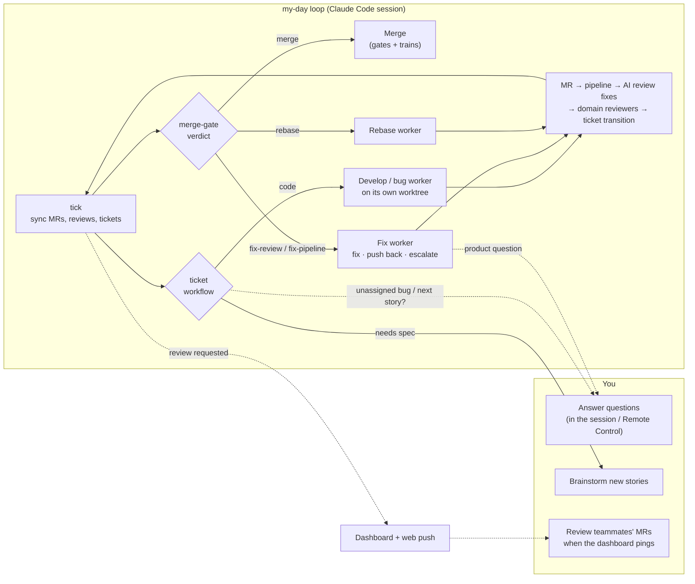

# my-day

A run-forever development loop for [Claude Code](https://claude.com/claude-code). You start
it once; it keeps your merge requests moving, fixes review comments, develops the tickets
assigned to you on isolated git worktrees, triages unassigned work, and only pulls you in
for the things that need a human: brainstorms, decisions and reviews.

Everything is configured per workspace in plain markdown (`.my-day/*.md`), so the same
skills work with Jira, GitHub Issues, GitLab Issues, Linear or no tracker at all, on GitLab
or GitHub.

## How it helps



| Without my-day | With my-day |
|---|---|
| You poll GitLab/GitHub and Jira to find what moved | `tick` syncs everything and says what to act on |
| Approved MRs wait until you notice them | Mergeable MRs are merged once every gate passes |
| AI-reviewer and human comments pile up | A worker fixes or reasons back on each thread, then re-requests review |
| Rebasing ff-only repos is a manual train | Rebases run server-side first, locally only when needed |
| Tickets wait for a free afternoon | Specified tickets are developed on worktrees in the background |
| Unassigned bugs go unnoticed | You're asked whether to take them; fixes can start in the background |

## Skills

| Skill | Role |
|---|---|
| `my-day-loop` | Orchestrator. Bootstraps, runs `tick`, acts, dispatches workers, schedules the next wakeup. Holds the shared code. |
| `my-day-setup` | First-run interview: tracker, code host, scope, workflow → writes `.my-day/*.md` from templates. |
| `my-day-config` | Turns standing decisions made while the loop runs ("ignore ABC-50", "never merge on Fridays") into config edits. |
| `my-day-worker` | Background agent: `develop`, `bug`, `review-fix`, `pipeline-fix`, `rebase` — each on its own git worktree. |
| `my-day-summary` | "What happened today?", failures, `elaborate <id>`. |

## Requirements

- Claude Code, with the `loop` skill (built in) and ideally the
  [superpowers](https://github.com/obra/superpowers) skills (debugging, TDD, code review).
- Node.js ≥ 22.13 (uses the built-in `node:sqlite`; developed on Node 24).
- `glab` (GitLab) or `gh` (GitHub), authenticated.
- Access to your tracker: an MCP server (e.g. Atlassian for Jira, Linear) or a CLI
  (`gh issue`, `glab issue`, `az boards`).

## Install

```bash
git clone git@github.com:csutorasr/my-day.git
cd my-day
./install.sh            # symlinks skills/* into ~/.claude/skills and installs the dashboard's web-push dependency
```

`install.sh` backs up any existing `~/.claude/skills/my-day-*` directory before linking.
Web push is optional; without `web-push` installed the dashboard still works and shows
notifications while the tab is open.

## First run

In the root of the workspace you want the loop to work on:

```
/my-day-loop
```

With no `.my-day/` yet, `my-day-setup` interviews you (one question at a time, proposing what
it found): which tracker and code host you use, which tickets count as your development work,
which bucket tickets to ignore, how bugs and stories flow, your merge gates, who reviews what.
Then the dashboard opens at `http://127.0.0.1:4711` and the loop starts.

## Configuration

`.my-day/` in the workspace root. Every `X.md` is shared with the team (commit it); an
optional `X.local.md` next to it holds personal overrides and is gitignored.

| File | Defines |
|---|---|
| `LOOP.md` | Cadence, working hours, parallel agents, retry limit, dry run — plus the scope the Node side reads: `tracker`, `forge`, `group`, `ticketPattern`, `aiReviewer`, `targetBranch` |
| `QUERY-MY-TASKS.md` | Tracker queries for your tickets; ignored bucket tickets |
| `QUERY-MY-REVIEWS.md` | Review-queue behaviour (the sync itself is automatic) |
| `QUERY-INBOX.md` / `TRIAGE.md` | Unassigned work and how to triage it |
| `WORKFLOW-BUG.md` / `-STORY.md` / `-SUBTASK.md` | Human-readable state machines: fix-first vs spec-first, CI plan vs local, brainstorm skills |
| `DEVELOP.md` | Worktrees, branch names, cross-repo order, per-repo tooling |
| `FIX-REVIEW.md` | How review comments are classified and answered |
| `MERGE-GATES.md` | Gates, merge method, rebase and force-push rules, merge trains |
| `POST-MR.md` | Pipeline handling, reviewer selection, ticket transitions |

Add to `.gitignore`:

```
.my-day/*.local.md
.my-day/state.db*
.my-day/.vapid.json
.my-day/server.pid
.my-day/server.log
.worktrees/
```

## Everyday use

- The loop talks to you in its Claude Code session — use Remote Control to follow it from
  your phone. Questions get IDs (`q-4 · bug-2 …`); answer in the session.
- Items have short IDs: `bug-1`, `story-2`, `mr-4`, `review-5`.
- `summary`, `summary since Monday`, `elaborate bug-1`, `retry bug-1`, `pause`, `resume`,
  `stop`.
- The dashboard lists reviews waiting for you (with Done / Skip), open questions, failures
  with links, all tasks and the activity log, and sends web push notifications.

## How it works

The model only does what needs judgement. Everything deterministic runs in Node through one
CLI, `skills/my-day-loop/bin/state.mjs`, backed by SQLite in `.my-day/state.db`:

| Command | Does |
|---|---|
| `bootstrap` | Config check, DB, dashboard server, orphaned agents |
| `tick` | Code-host sync (MRs + review requests), merge-gate verdicts, schedule, compact to-do JSON |
| `dispatch` / `reconcile` | Worker bookkeeping: attempts, links, new MRs, retry limit → escalation |
| `summary`, `show`, `list`, `ask`, `answer`, … | State queries and updates (`state.mjs help`) |

`bin/forge.mjs` reads GitLab (`glab`) and GitHub (`gh`) with one output shape. The
orchestrator writes all task state; workers only report a JSON result.

## Safety

- **Dry run** (`dryRun: true`) replaces every outward action with a logged event — use it to
  rehearse a new setup.
- **Working hours** gate dispatching and outward actions (read-only refresh continues).
- Merges only when every gate in `MERGE-GATES.md` passes; force-push only where that file
  allows it (e.g. `--force-with-lease` after a failed server-side rebase).
- Personal data stays in `*.local.md`; the shared files use "current user" queries.

## Development

```bash
npm test     # node --test, no dependencies needed
```

Status: early. Used daily on a Jira + GitLab workspace; the GitHub provider is covered by
fixture tests only.
