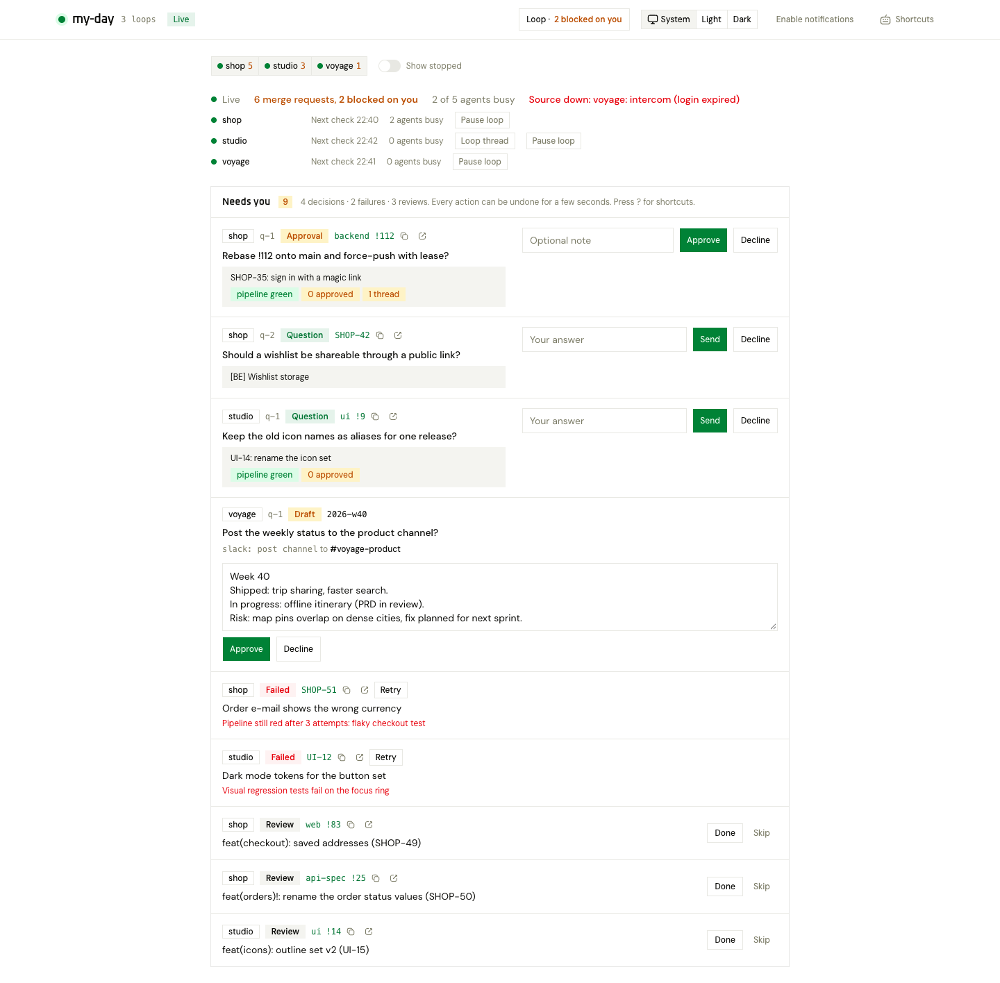
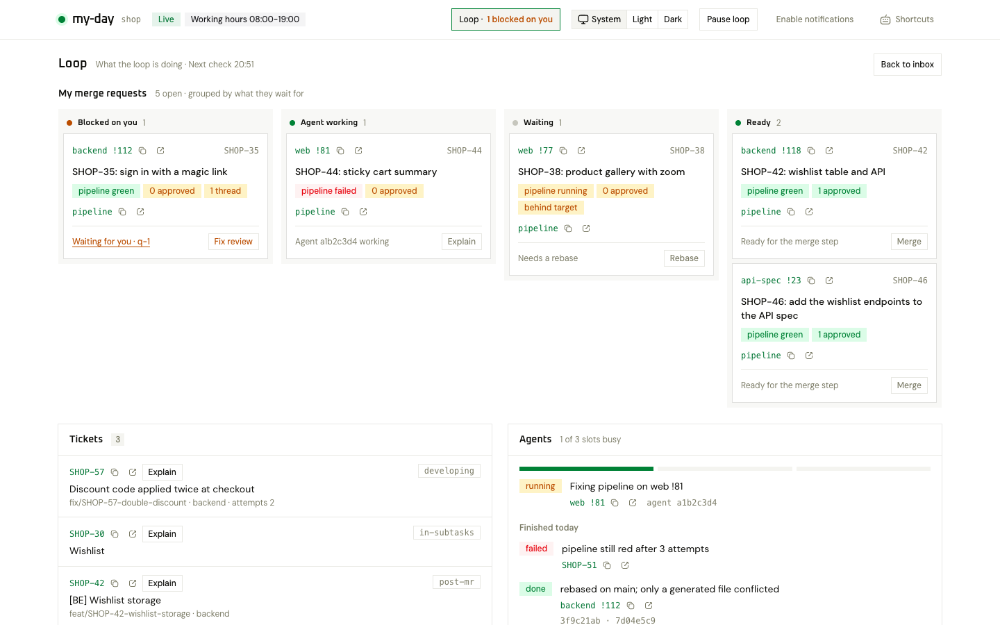

# my-day

A run-forever development loop for [Claude Code](https://claude.com/claude-code), also in a
[T3 Code](https://t3.codes) thread (see [Using with T3 Code](#using-with-t3-code)). You start
it once; it keeps your merge requests moving, fixes review comments, develops the tickets
assigned to you on isolated git worktrees, triages unassigned work, and only pulls you in
for the things that need a human: brainstorms, decisions and reviews.

Everything is configured per workspace in plain markdown (`.my-day/*.md`), so the same
skills work with Jira, GitHub Issues, GitLab Issues, Linear or no tracker at all, on GitLab
or GitHub. The loop itself is generic — it resolves whatever tasks its markdown describes; the
development workflow above is the `dev` **profile**, the template set setup starts from, and the
`pm` profile runs a product manager's day the same way (backlog hygiene, specs, feedback,
stakeholder replies, status updates). Run one loop per workspace folder; one dashboard shows
them all.





## How it helps


| Without my-day | With my-day |
|---|---|
| You poll GitLab/GitHub and Jira to find what moved | `tick` syncs everything and says what to act on |
| Approved MRs wait until you notice them | Mergeable MRs are merged once every gate passes |
| AI-reviewer and human comments pile up | A worker fixes or reasons back on each thread, then re-requests review |
| Rebasing ff-only repos is a manual train | Rebases run server-side first, locally only when needed |
| Tickets wait for a free afternoon | Specified tickets are developed on worktrees in the background |
| Unassigned bugs go unnoticed | You're asked whether to take them; fixes can start in the background |

## Skills

| Skill | Role |
|---|---|
| `my-day:loop` | Orchestrator. Bootstraps, runs `tick`, acts, dispatches workers, schedules the next wakeup. Holds the shared code. |
| `my-day:setup` | First-run interview → writes `.my-day/*.md` from a profile's templates (`setup dev`, `setup pm`; see [Profiles](#profiles)). Registers the workspace for the shared dashboard. |
| `my-day:config` | Turns standing decisions made while the loop runs ("ignore ABC-50", "never merge on Fridays") into config edits. |
| `my-day:worker` | Background agent (a subagent, a `claude -p` process or a T3 Code thread): `develop`, `bug`, `review-fix`, `pipeline-fix`, `rebase` — each on its own git worktree. |
| `my-day:summary` | "What happened today?", failures, `elaborate <id>`. |
| `my-day:dream` | Periodic local reflection (`dreamSchedule`, e.g. weekly): reads the loop's history, writes a report to `.my-day/dreams/`, proposes config edits for approval, flags team and tooling issues. Never runs in the cloud. |

## Requirements

- Claude Code — or T3 Code running Claude threads — with the `loop` skill (built in) and ideally
  the [superpowers](https://github.com/obra/superpowers) skills (debugging, TDD, code review).
- Node.js ≥ 22.13 (uses the built-in `node:sqlite`; developed on Node 24).
- `glab` (GitLab) or `gh` (GitHub), authenticated.
- Access to your tracker: an MCP server (e.g. Atlassian for Jira, Linear) or a CLI
  (`gh issue`, `glab issue`, `az boards`).

## Install

In Claude Code:

```
/plugin marketplace add csutorasr/my-day
/plugin install my-day@csutorasr
```

(or from a shell: `claude plugin marketplace add csutorasr/my-day && claude plugin install my-day@csutorasr`).
The repository is private for now, so this needs git access to it.

Skills are namespaced by the plugin: `/my-day:loop`, `my-day:setup`, ….
Web push is optional — setup offers to install its one dependency (`web-push`); without it
the dashboard still notifies while its tab is open.

## First run

In the root of the workspace you want the loop to work on:

```
/my-day:loop
```

With no `.my-day/` yet, `my-day:setup` interviews you (one question at a time, proposing what
it found): which tracker and code host you use, which tickets count as your development work,
which bucket tickets to ignore, how bugs and stories flow, your merge gates, who reviews what.
Then the dashboard opens at `http://127.0.0.1:4711` and the loop starts.

## Several loops

Start `/my-day:loop` in each workspace folder you want worked on (`~/work/client-a`,
`~/work/client-b`, …): one Claude Code session (or T3 Code thread) per folder, each with its own `.my-day/` store and
config. The first loop starts the machine's one dashboard; the others join it. The dashboard shows
the loops whose session is running; with more than one, a filter picks workspaces and **Show
stopped** adds the rest. `stop` in a session marks its loop stopped (`state.mjs stop`).

The machine home `~/.my-day/` (`MY_DAY_HOME`) holds the list of loops (`loops/`), the dashboard's
process files, its web-push keys and subscriptions, and an optional `SETTINGS.md` with `port` and
`pushSubject` (otherwise the first loop's `LOOP.md` values). Upgrading from 0.7: keys and phone
subscriptions move there on the first start; **restart running loops after updating** so none of
them still runs the per-workspace dashboard.

### Profiles

A profile is a folder under `skills/loop/templates/` with a `SETUP.md` (its interview) and the
files it writes. `LOOP.md`'s `## Files` section lists the files a workspace's loop needs and its
*Tick priority* says what each step does, so a new kind of loop (a UX loop fed by other sessions,
a team-lead loop with weekly 1:1 prep, …) is a new template folder, not new code. Item types are
free (`request`, `1on1`, …); `forge: none` turns off the code-host sync.

| Profile | For |
|---|---|
| `dev` | Repos side by side under the workspace root; workers are subagents of the loop session (or T3 Code threads, `runner: t3`) |
| `dev-bundle` | A **bundle repo** that gitignores several cloned repos inside it; every code step runs as `claude -p` in the repo's worktree (`runner: claude-p`; `runner: t3` runs the same chain as T3 Code threads) |
| `pm` | A product manager: grooms the backlog against a definition of ready, takes ideas and epics to a PRD and stories, groups feedback from chat and support into tickets, drafts replies to stakeholders and a scheduled status update. No code host, no workers; every message, comment or ticket it sends is a draft you approve, unless `WRITES.md` says otherwise |

Two things every profile shares:

- **Outward writes** (`WRITES.md`): each action the loop takes outside the workspace
  (`jira: comment`, `slack: post channel`, `gitlab: merge`, `gmail: send` …) is `auto`, `ask` or
  `never`. An `ask` becomes a **draft** in the inbox: what it writes where, the text editable in
  place, Approve / Decline; the loop writes exactly what you approved. `never` is refused, with a
  fallback where one fits (an email draft instead of sending). Without a `WRITES.md` everything is
  `auto`, which is how dev workspaces have always run.
- **Required sources** (`requires:` in `LOOP.md`, e.g. `mcp:atlassian, mcp:slack, cli:glab`):
  the MCP servers and CLIs the loop cannot work without. CLIs are checked at start, MCP servers
  by the session; a source that is missing or failing shows in the dashboard's health strip, its
  steps are skipped, and the loop never mistakes its silence for "nothing to do".

### Workers as `claude -p`

`runner: claude-p` in `LOOP.md` runs each worker as a separate, detached `claude -p` process started
in the worktree of the repo it works on — so that repo's `CLAUDE.md`, tracked
`.claude/settings.json`, skills and MCP servers apply, exactly as in a fresh session there. A ticket
that touches several repos runs one process per repo in `DEVELOP.md`'s cross-repo order; each gets
the earlier repos' results, and a failed or blocked repo stops the chain. Runs are tracked in
`.my-day/runs/`, outlive the loop session and are collected by the next tick; the dashboard shows
which repo a chain is in and offers **Stop run**. Settings: `permissionMode` (default `acceptEdits`;
runs cannot answer prompts, so allow a repo's build and test commands in its
`.claude/settings.json`), `runTimeoutMinutes` (90), `claudeBin`. The default `runner: agent` keeps
subagents.

Smoke test by hand (CI uses a fake `claude`): in a workspace with `runner: claude-p`, make a
worktree, then `state.mjs run <item> --kind develop --task "add a line to README, local only" --chain <repo>=<worktree>`;
`state.mjs runs` shows it running, and the next `tick` reports it under `runs.finished`.

## Using with T3 Code

[T3 Code](https://t3.codes) runs Claude threads on the Claude Code harness, so the plugin works in
a T3 thread as it does in a terminal: the loop, its wakeups and the dashboard watch are the same.
What changes is where you follow the loop, and that workers can run as T3 threads of their own.

- **Install** the plugin at **user** scope (`claude plugin marketplace add csutorasr/my-day &&
  claude plugin install my-day@csutorasr --scope user`), start a Claude thread in the workspace's
  T3 project and send `/my-day:loop`. Setup notices T3 Code, offers to register the workspace as
  a T3 project (`t3 project add`, only after asking) and asks how workers should run.
- **The loop's thread.** `bootstrap` reports `host: t3` with the loop's own thread and its link
  (asked from the `t3` CLI once per session; T3 Code names the CLI in `$T3CODE_CLI_PATH`). The
  dashboard opens in an in-app tab (`preview_open`) instead of the system browser and shows a
  **Loop thread** link back to that thread (per loop in the health strip when several are shown).
  You follow the loop in its thread, on desktop or phone; Claude Code's Remote Control is not
  needed (and not there).
- **The watch.** T3 Code has no `TaskList` tool, so the loop never looks for its running watch:
  `state.mjs watch` can be started again at any time. The newest one takes over
  (`.my-day/watch.lock`) and the older one prints `watch-replaced` and ends; an event is reported
  by one watch only.
- `claude -p` workers (`runner: claude-p`) started from a loop in T3 Code do not inherit its
  `CLAUDE_CODE_ENTRYPOINT` / `T3CODE_*` variables: they are not the loop's thread.

### Workers as T3 threads

`runner: t3` in `LOOP.md` runs every worker step as its own T3 Code thread, started from Node
through the `t3` CLI, in the same chain model as `claude -p`: one thread per repo in
`DEVELOP.md`'s cross-repo order, each given the earlier repos' results; a failed or blocked repo
stops the chain; `tick` collects finished threads and reconciles the item at the end.

- *Where a worker runs.* A T3 thread runs in its project's folder, and `t3 thread start` takes no
  other folder (its `--worktree` always makes a new worktree on a new branch). So the runner
  registers the worktree the loop made as its own T3 project (`<repo> · <branch>`) and starts the
  thread there: the repo's `CLAUDE.md`, `.claude/settings.json` and skills apply, exactly as for
  `claude -p`. `t3Project: containing` registers nothing: the thread starts in the registered
  project that holds the worktree (the workspace or the repo) and the worker `cd`s into it — a
  quieter sidebar, but the session is the project's, not the worktree's.
- *How they look.* Threads are titled `ABC-12 develop · backend (story-3-1): <ticket title>` (the
  chain id makes the title unique: a start whose answer got lost is found by it). Each thread's
  link is in `state.mjs runs`, among the item's links (`[thread] backend worker`) and in the
  dashboard's agents panel (**Open thread**), from the first time the loop looks at the thread.
  You can open a worker, watch it, and talk to it.
- *A worker that asks.* A thread can stop for a question or an approval. That is not a failure:
  `tick` lists it under `runs.waiting`, `watch` wakes the loop with `run-waiting` (and with
  `run-resumed` once you answered), the loop tells you in its thread, the dashboard's health strip
  says "1 worker is waiting for your answer" with the link, and a web push opens the thread. The
  time the loop sees a worker waiting is added to its `runTimeoutMinutes`; `watch` notices a wait
  and its end within `t3PollSeconds`, so only a wait answered before that counts as working time.
- *Results.* The worker's report is its last message (the same JSON block as everywhere),
  read with `t3 thread show --json`; a report written before the thread went on with background
  work counts. A thread that ends without one is reminded once (`t3 thread send`, tried again on
  the next tick if it cannot be sent) before the step fails. `--output-schema` is not used: its
  output only comes back from a `--wait` process held open for the whole run, which the runner
  deliberately does not keep (nothing but the thread id has to survive a restart, and it is
  written down as soon as the thread exists).
- *Models.* `t3Model` (with `t3Provider`, default `claudeAgent`, and `t3Options`, e.g.
  `effort=high`); empty = the T3 project's default model. Per kind: `t3Model<Kind>` (plus
  `t3Provider<Kind>`, `t3Options<Kind>`; `Kind` = `Develop`, `Bug`, `ReviewFix`, `PipelineFix`,
  `Rebase`), e.g. `t3ModelRebase: claude-haiku-5-5`. Another provider works by configuration
  (`t3Provider: codex`): the prompt names the worker skill's file for threads without a Skill
  tool. That path is untested with a real Codex thread.

| Setting | Default | |
|---|---|---|
| `runner` | `agent` | `t3` = workers as T3 Code threads |
| `t3Bin` | | The `t3` CLI: `$T3_BIN`, then this, then `$T3CODE_CLI_PATH` (set inside a T3 thread), then `t3` on `PATH` |
| `t3Provider`, `t3Model`, `t3Options` | `claudeAgent`, project default, none | Model of the worker threads; per kind with a `<Kind>` suffix |
| `t3Project` | `worktree` | `worktree`: each worker worktree becomes a T3 project · `containing`: use the project that holds it |
| `t3Cleanup` | `keep` | `remove`: when the loop removes a worktree, also `state.mjs t3 remove <worktree>` |
| `t3PollSeconds` | `10` | How often `watch` asks T3 Code about running worker threads |
| `runTimeoutMinutes` | `90` | A thread still working after this fails its step |

**Limits.**
- **The `t3` CLI cannot stop a thread.** **Stop run** (`run-stop`) and a timeout end the chain and
  cancel the later repos; they list the thread under `stillRunning`, and a loop running in T3 Code
  interrupts it with T3's `t3_thread_interrupt` tool. Elsewhere the thread works on until you
  press Stop in it, and the loop passes on its link. Until it has stopped, `run` refuses to start
  another worker on that item or worktree (naming the thread); `run --force` starts anyway.
- With `t3Project: worktree` every worker worktree stays in the sidebar as a project. T3 Code only
  removes a project that has threads together with them: `t3Cleanup: remove` does that when the
  loop removes the worktree (`state.mjs t3 remove`, which refuses anything but a worker worktree
  the runner registered: never the workspace, a folder that holds it, or with
  `t3Project: containing`); `keep` leaves the threads to read later.
- Worker threads start in a worktree, where a project-scope enable of the plugin does not apply:
  enable it at user scope. (Without it the prompt still points the worker at the skill's file.)
- The runner needs the T3 Code server running: `cli:t3` becomes a required source, checked at the
  first `bootstrap` of every session and shown in the dashboard's health strip when it is down.

`state.mjs t3 check [path …]` says whether the CLI and the server answer and which folders are T3
projects; `t3 register <path>` adds one. Smoke test by hand (CI uses a fake `t3`), in a workspace
with a worktree: `state.mjs run <item> --kind develop --runner t3 --task "add a line to README, local only" --chain <repo>=<worktree>`,
then `state.mjs tick` for the link (and `state.mjs runs`) and, once it is done, the result.

## Configuration

`.my-day/` in the workspace root. Every `X.md` is shared with the team (commit it); an
optional `X.local.md` next to it holds personal overrides and is gitignored.

| File | Defines |
|---|---|
| `LOOP.md` | Cadence, working hours, parallel agents, retry limit, dry run, the worker `runner` (`agent`, `claude-p`, `t3`) and its settings, `dreamSchedule` and any other `<name>Schedule` (e.g. `statusSchedule: Fri 14:00`) — plus the scope the Node side reads: `tracker`, `forge`, `group`, `ticketPattern`, `aiReviewer`, `targetBranch`, `requires`. Body: `## Files` (the manifest) and *Tick priority* |
| `WRITES.md` | `auto` / `ask` / `never` per outward action (every profile; optional, absent = all `auto`) |
| `QUERY-MY-TASKS.md` | Tracker queries for your tickets; ignored bucket tickets |
| `QUERY-MY-REVIEWS.md` | Review-queue behaviour (the sync itself is automatic) |
| `QUERY-INBOX.md` / `TRIAGE.md` | Unassigned work and how to triage it |
| `WORKFLOW-BUG.md` / `-STORY.md` / `-SUBTASK.md` | Human-readable state machines: fix-first vs spec-first, CI plan vs local, brainstorm skills |
| `DEVELOP.md` | Worktrees, branch names, cross-repo order, per-repo tooling |
| `FIX-REVIEW.md` | How review comments are classified and answered |
| `MERGE-GATES.md` | Gates, merge method, rebase and force-push rules, merge trains |
| `POST-MR.md` | Pipeline handling, reviewer selection, ticket transitions |
| `DREAM.md` (optional) | Checks `my-day:dream` runs over the loop's history; defaults to the template |

The table lists the `dev` profile's files; the `pm` profile has `QUERY-BACKLOG.md`, `HYGIENE.md`,
`QUERY-FEEDBACK.md`, `FEEDBACK.md`, `QUERY-MENTIONS.md`, `WORKFLOW-SPEC.md` and `STATUS.md`
instead.

Add to `.gitignore`:

```
.my-day/*.local.md
.my-day/state.db*
.my-day/dreams/
.my-day/runs/
.my-day/watch.lock*
.worktrees/
```

## Everyday use

- The loop talks to you in its session: a T3 Code thread (desktop or phone), or a Claude Code
  session you follow from your phone with Remote Control. Questions get IDs (`q-4 · bug-2 …`); answer in the session.
- Items have short IDs: `bug-1`, `story-2`, `mr-4`, `review-5`.
- `summary`, `summary since Monday`, `elaborate bug-1`, `retry bug-1`, `pause`, `resume`,
  `stop`.
- The dashboard puts everything that needs you in one inbox: decisions (answer, approve or
  decline right there, with the MR's title and gates beside the question), drafts of outward
  writes (edit the text, then approve or decline), failures and review requests (Done / Skip),
  under a health strip (live, next check, MRs blocked on you, agents busy, sources down, worker threads waiting for your answer); the tab title shows the count. The Loop button (or `l`) opens the loop view over it: your
  MRs grouped by what they wait for, tickets, agents and the activity log (`#loop` survives a
  reload; Esc goes back, and "Waiting for you" on an MR card jumps to that question). It also
  sends web push notifications. Every dashboard action waits a few seconds
  with Undo before it reaches the loop. Keyboard: `j`/`k` move through the inbox, `a` approves or
  sends, `d` declines, `u` undoes, `c` copies a link, `?` lists them. On a phone the dashboard is the inbox
  only, and approvals are not offered: decide those on a larger screen. Every MR / ticket / link has quick actions: copy, open, and a loop
  action (rebase, fix pipeline, fix review, merge step, retry, ask why). Pause / resume the loop
  from the header (with several loops shown: per loop, in the health strip). The loop view shows
  one loop at a time, with a switcher when several are shown.
- Dashboard clicks reach the loop on its next `tick` (`fromDashboard`); the loop also runs
  `state.mjs watch` as a monitor, so a click (or a finished run, or a worker's T3 thread that
  waits for you) wakes it within seconds.

## How it works

The model only does what needs judgement. Everything deterministic runs in Node through one
CLI, `skills/loop/bin/state.mjs`, backed by SQLite in `.my-day/state.db`:

| Command | Does |
|---|---|
| `bootstrap` | Config check, DB, registers the loop in `~/.my-day`, one-time migration, shared dashboard server, the host (Claude Code or a T3 Code thread), orphaned agents |
| `loops`, `stop` | The machine's loops (running / stopped); mark this loop stopped |
| `run`, `runs`, `run-stop` | Workers per repo as `claude -p` processes (`runner: claude-p`) or T3 Code threads (`runner: t3`): start a chain, list (with thread links), stop |
| `t3 check`, `t3 register`, `t3 remove` | The `t3` CLI and its server; folders as T3 projects; remove a worker worktree's project |
| `tick` | Code-host sync (MRs + review requests), merge-gate verdicts, schedule, compact to-do JSON |
| `dispatch` / `reconcile` | Worker bookkeeping: attempts, links, new MRs, retry limit → escalation |
| `dream-data` / `dream-done` | History bundle for a dream; record `lastDreamAt` |
| `ask --draft`, `wrote` | A draft of an outward write to approve; mark an approved one written (`tick` lists approved drafts until then) |
| `source`, `sources`, `schedule-done` | Health of the required sources; record a `<name>Schedule` run |
| `pause` / `resume`, `watch` | Stop dispatching; stream dashboard clicks, finished runs and waiting worker threads to the session (safe to start twice: the newest watch takes over) |
| `summary`, `show`, `list`, `ask`, `answer`, … | State queries and updates (`state.mjs help`) |

`bin/forge.mjs` reads GitLab (`glab`) and GitHub (`gh`) with one output shape. The
orchestrator writes all task state; workers only report a JSON result.

## Safety

- **Dry run** (`dryRun: true`) replaces every outward action with a logged event — use it to
  rehearse a new setup.
- **Outward writes** follow `WRITES.md`: `ask` ones wait for your approval as drafts, `never`
  ones are refused; workers hand theirs back as drafts.
- **Working hours** gate dispatching and outward actions (read-only refresh continues).
- Merges only when every gate in `MERGE-GATES.md` passes; force-push only where that file
  allows it (e.g. `--force-with-lease` after a failed server-side rebase).
- Personal data stays in `*.local.md`; the shared files use "current user" queries.

## Development

```bash
npm test     # node --test, no dependencies needed
```

The dashboard UI is a React app built with Vite, Tailwind CSS v4 and
[shadcn/ui](https://ui.shadcn.com) components on Base UI (`skills/loop/ui`, an npm workspace; theme
from the shadcn preset `b5r7j0sfMW`). The build output in `skills/loop/server/public` is committed,
so an installed plugin never builds anything.

```bash
npm install          # Vite, React, Tailwind, shadcn and Playwright, development only
npm run ui:dev       # hot reload against the running dashboard (MY_DAY_URL, default :4711)
npm run ui:demo      # the real server on three imaginary workspaces (skills/loop/e2e/seed.mjs), port 4712
npm run ui:dev:demo  # hot reload against `ui:demo`
npm run ui:build     # rebuild skills/loop/server/public; commit the result
npm run test:e2e     # build, seed the imaginary workspaces, drive the dashboard in Chrome
```

Add a shadcn component from `skills/loop/ui`: `pnpm dlx shadcn@latest add <name>` (it lands in
`src/components/ui`; dependencies go to the workspace's `package.json`).

`npm test` fails when the committed build is older than the UI sources. `npm run test:e2e`
also rewrites the screenshots at the top of this README (`docs/dashboard.png`,
`docs/dashboard-loop.png`); commit it after a
visible UI change, see [AGENTS.md](AGENTS.md).

Status: early. Used daily on a Jira + GitLab workspace; the GitHub provider is covered by
fixture tests only.
